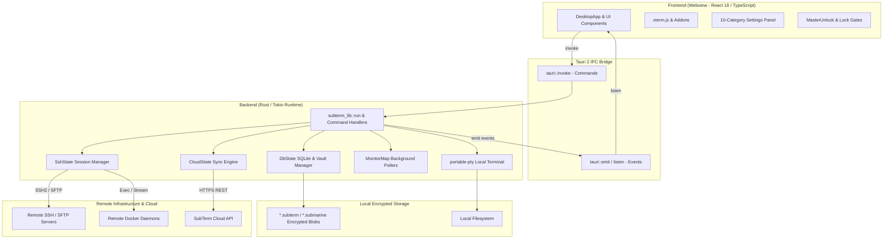

# SubTerm Architecture & System Design

SubTerm is a cross-platform SSH, SFTP, terminal, and infrastructure management client built using **Tauri v2** (Rust backend) and **React 18 + TypeScript + Vite** (frontend UI). It compiles into native executables for Windows, macOS, Linux, and Android APKs.

This document details the internal design, component boundaries, IPC communications, cryptographic vault architecture, and state synchronization.

---

## 1. High-Level System Architecture

SubTerm follows Tauri's two-tier architecture:
- **Core Runtime (Rust / Tokio)**: Handles low-level networking, SSH2/SFTP protocol negotiation (`russh`), local pseudoterminal (PTY) allocation (`portable-pty`), AES-256-GCM encrypted SQLite vault storage, background system resource monitoring, and Docker daemon communication over SSH.
- **Presentation Layer (React / Vite / TypeScript)**: Renders the interface, manages active terminal tabs with `xterm.js`, provides visual SFTP file exploration, interactive port forwarding drawers, Docker container views, and the VS Code-style Settings panel.



---

## 2. Component Breakdown

### 2.1 Backend State Singletons (`src-tauri/src/lib.rs`)

The Rust application initializes and manages several concurrent thread-safe states passed to Tauri command handlers:

1. **`DbState`**:
   - `conn`: `Arc<StdMutex<Option<rusqlite::Connection>>>` - In-memory SQLite connection holding unencrypted session data when unlocked.
   - `master_key`: `StdMutex<Option<[u8; 32]>>` - AES-256 key derived via Argon2id from the master password.
   - `salt`: `StdMutex<Option<[u8; 16]>>` - 16-byte random salt stored in the vault blob header.
   - `db_path`: `StdMutex<Option<PathBuf>>` - Active `.subterm` profile path on disk.
   - `active_profile`: `StdMutex<Option<String>>` - Name of active workspace profile.
   - `hlc`: `StdMutex<Option<Hlc>>` - Hybrid Logical Clock instance for distributed conflict-free ordering across multi-device sync.
   - `session_password`: `StdMutex<Option<String>>` - In-memory master password used to seamlessly persist or switch profiles without re-prompting.

2. **`SshState` (`src-tauri/src/commands/servers.rs`)**:
   - Manages active remote connections indexed by `session_id`.
   - Owns `russh::client::Handle` instances, active channel handlers, jump host proxies, and tunnel forwarders.

3. **`DockerStreams` (`src-tauri/src/docker.rs`)**:
   - Tracks live streaming handles (`tokio::task::AbortHandle`) for remote container log tailing (`ssh_docker_logs_start`).

4. **`MonitorMap` & `SharedSettings` (`src-tauri/src/monitor.rs`)**:
   - Manages background Tokio polling loops per remote host that collect CPU, memory, load, and disk metrics via SSH exec commands.
   - Hot-reloads global polling intervals and thresholds without restarting monitors.

5. **`MirrorMap` (`src-tauri/src/mirror.rs`)**:
   - Manages real-time bidirectional local-to-remote folder file synchronization tasks using filesystem watchers (`notify` crate).

6. **`CloudState` (`src-tauri/src/cloud.rs`)**:
   - Handles account authentication, bearer token persistence (`cloud_token.json`), and uploading/downloading encrypted vault blobs to the sync API.

---

## 3. Cryptographic Vault Storage Format

SubTerm enforces a zero-knowledge local storage model. Profile configuration files (`*.subterm` and legacy `*.submarine`) are encrypted at rest using **Argon2id** and **AES-256-GCM**.

### 3.1 Vault Binary File Structure

When a profile is persisted (`persist_vault`), the in-memory SQLite database is dumped into a byte buffer using SQLite's native serialization (`sqlite3_serialize`), compressed with Zstandard (v2 format), encrypted, and written to disk:

```
+----------------+---------------+-------------------+-------------------+-------------------------+
| Magic (4B)     | Version (1B)  | Salt (16B)        | Nonce / IV (12B)  | Ciphertext + Tag (var)  |
| 0x53 55 42 54  | 0x02          | Cryptographic     | AES-GCM Nonce     | Encrypted SQLite DB     |
| ("SUBT")       |               | Random Salt       | (ThreadRng)       | with GCM Auth Tag       |
+----------------+---------------+-------------------+-------------------+-------------------------+
```

### 3.2 Cryptographic Parameters

- **Key Derivation**: Argon2id (RFC 9106)
  - Memory cost (`m_cost`): `64 MiB` (`65,536 KiB`)
  - Time cost (`t_cost`): `3 passes`
  - Parallelism (`p_cost`): `4 lanes`
  - Output length: `32 bytes` (256 bits)
- **Encryption**: AES-256-GCM (`aes-gcm` crate)
  - Key size: 256 bits
  - Nonce size: 96 bits (12 bytes, generated using `rand::thread_rng()`)
  - Authentication tag: 128 bits (appended to ciphertext)

### 3.3 Security Invariants
- The vault password is never written to disk.
- When locked, the in-memory SQLite connection is closed and freed, and `master_key` is zeroed/cleared from memory.
- Cloud sync operates purely on pre-encrypted blobs; the remote cloud server has no knowledge of encryption keys or database contents.

---

## 4. SSH & Terminal Subsystems

### 4.1 Remote SSH (`russh`)
- Written on top of asynchronous Tokio networking.
- Implements interactive PTY allocation (`pty-req`, `shell`), terminal resizing (`window-change`), and streaming stdout/stderr back to the frontend over Tauri events.
- Output coalescing: Raw terminal byte chunks are buffered (20 ms window) and hex-encoded to minimize IPC serialization overhead across the webview bridge.

### 4.2 Local Terminal (`portable-pty`)
- Spawns platform-native shells without requiring SSH:
  - **Windows**: `powershell.exe` or `cmd.exe` via ConPTY.
  - **macOS / Linux**: User's `$SHELL` (or `/bin/bash` / `/bin/sh`).
- Operates on a dedicated worker thread with reader/writer pipes communicating with the frontend.

### 4.3 Port Forwarding (Tunnels)
SubTerm supports three tunnel modalities:
1. **Local Forwarding (`-L`)**: Binds a local port; incoming TCP connections are forwarded through the encrypted SSH session to a remote host and port.
2. **Remote Forwarding (`-R`)**: Requests the remote SSH daemon to bind a port on the remote machine and forward inbound connections back to a local port or service.
3. **Dynamic Forwarding (`-D` / SOCKS5)**: Creates a local SOCKS5 proxy server allowing arbitrary browser/tooling traffic to route through the SSH connection.

---

## 5. Settings Panel Architecture

The Settings interface (`src/components/SettingsPanel.tsx`) uses a 10-category vertical sidebar model:

| Category ID | Display Name | Protection Level | Primary Operations |
|---|---|---|---|
| `appearance` | Appearance | Unrestricted | UI themes, accent colors, zoom levels |
| `terminal` | Terminal | Unrestricted | Font family/size, scrollback, command widget |
| `monitoring` | Monitoring | Unrestricted | Polling toggles, interval configurations |
| `shortcuts` | Keyboard Shortcuts | Unrestricted | Global keybinding customizer & recorder |
| `quickaccess` | Quick Access Servers | **Vault Locked** | Pin/unpin top-bar nodes, host/IP display |
| `cloud` | Cloud & Sync | **Vault Locked** | Cloud API endpoint, auth, push/pull sync |
| `profile` | Profiles & Vault | **Vault Locked** | Create/delete/rename profiles, master password |
| `commands` | Quick Commands | **Vault Locked** | Manage executable scripts & sensitive snippets |
| `maintenance` | Maintenance | **Vault Locked** | Factory reset preferences, storage cleanup |
| `activity` | Activity Log | **Vault Locked** | Session audits, connection diagnostic timeline |

Protected categories evaluate the application's `isUnlocked` state. If locked, the category renders a unified `LockedPage` gate requiring user unlock before sensitive configurations or credentials can be inspected or mutated.
