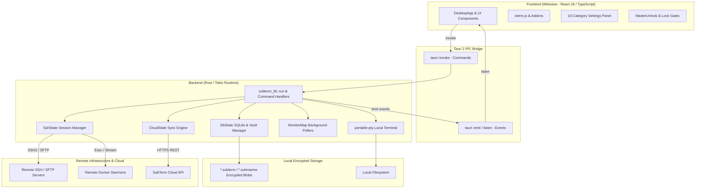

# SubTerm Architecture & System Design

SubTerm is a cross-platform SSH, SFTP, terminal, and infrastructure management client built using **Tauri v2** (Rust backend) and **React 18 + TypeScript + Vite** (frontend UI). It compiles into native executables for Windows, macOS, Linux, and Android APKs.

This document details the internal design, component boundaries, IPC communications, cryptographic vault architecture, and state synchronization.

---

## 1. High-Level System Architecture

SubTerm follows Tauri's two-tier architecture:
- **Core Runtime (Rust / Tokio)**: Handles low-level networking, SSH2/SFTP protocol negotiation (`russh`), local pseudoterminal (PTY) allocation (`portable-pty`), AES-256-GCM encrypted SQLite vault storage, background system resource monitoring, and Docker daemon communication over SSH.
- **Presentation Layer (React / Vite / TypeScript)**: Renders the interface, manages active terminal tabs with `xterm.js`, provides visual SFTP file exploration, interactive port forwarding drawers, Docker container views, and the VS Code-style Settings panel.



---

## 2. Component Breakdown

### 2.1 Backend Module Layout (`src-tauri/src/`)

`lib.rs` is deliberately thin: it holds only `DbState`, a handful of profile-path helpers, and `pub fn run()` (the Tauri `Builder` setup + `invoke_handler![]` command registry). Every command domain lives in its own module, split out so each file has one clear responsibility:

| Module | Responsibility |
|---|---|
| `vault.rs` | Argon2id key derivation, AES-256-GCM encrypt/decrypt, vault blob framing, zstd compress/decompress. |
| `ssh_manager.rs` | `SshState` (all live per-session connection/channel maps) and `ClientHandler` (the `russh::client::Handler` impl — host-key TOFU prompts, forwarded-tcpip bridging, SSH agent forwarding channel routing). |
| `ssh_agent.rs` | Connects to the local SSH agent (Unix socket / Windows named pipe) for agent forwarding. Proxies raw bytes only — never parses the ssh-agent protocol. |
| `tunnel.rs` | Local/remote/dynamic (SOCKS5) port-forward implementation. |
| `monitor.rs` | Background per-host polling loops (`MonitorMap`, `SharedSettings`) — the engine; DB bridging lives in `commands/monitor_settings.rs`. |
| `mirror.rs` | Bidirectional local↔remote folder sync engine (`MirrorMap`) using the `notify` crate — the engine; thin command wrappers live in `commands/mirror.rs`. |
| `cloud.rs` / `cloud_config.rs` | Cloud account auth, bearer token persistence, encrypted blob upload/download, self-hosted endpoint config. |
| `identity.rs` / `hlc.rs` | Per-member sealed-box key wrapping for profile sharing, and the Hybrid Logical Clock used to order synced row versions. |
| `docker.rs` | `DockerStreams` — live container log streaming handles over SSH exec. |
| `commands/connection.rs` | SSH connection establishment: keyboard-interactive auth, ProxyJump/bastion handshakes, `initiate_connection` (transport selection, auth ladder, per-session health watcher), disconnect/teardown, SSH error classification, and the sleep/resume + network-change watchers (§4.8). |
| `commands/profile.rs` | Profile lifecycle (list/select/switch/close/rename/delete/export/import), master-password change, the vault schema bootstrap (`setup_master_db`), known-hosts management. |
| `commands/sync.rs` | The HLC-based per-entity sync engine (schema backfill, triggers, LWW merge) and profile sharing/escrow (identity/share/invite/accept/revoke). |
| `commands/servers.rs`, `commands/sftp.rs`, `commands/terminal.rs`, `commands/tunnels.rs`, `commands/network.rs` | Server/credential/key CRUD, SFTP operations, terminal PTY commands, tunnel commands, and standalone network probes (WoL, port knocking). |
| `commands/diagnostics.rs` | Info-panel read-only probes, OS detection, iptables/nft inspection, systemctl/kill-process actions. |
| `commands/monitor_settings.rs` | DB↔poller glue for the Monitoring panel (reads/writes `monitor_configs`, drives `monitor.rs`'s `MonitorMap`). |
| `commands/mirror.rs` | Thin `#[tauri::command]` wrappers forwarding into `mirror.rs`. |

### 2.2 State Singletons

The Rust application manages several concurrent thread-safe states passed to Tauri command handlers:

1. **`DbState`** (`lib.rs`):
   - `conn`: `Arc<StdMutex<Option<rusqlite::Connection>>>` - In-memory SQLite connection holding unencrypted session data when unlocked.
   - `master_key`: `StdMutex<Option<Zeroizing<[u8; 32]>>>` - AES-256 key derived via Argon2id from the master password; zeroized on drop.
   - `salt`: `StdMutex<Option<[u8; 16]>>` - 16-byte random salt stored in the vault blob header.
   - `db_path`: `StdMutex<Option<PathBuf>>` - Active `.subterm` profile path on disk.
   - `active_profile`: `StdMutex<Option<String>>` - Name of active workspace profile.
   - `hlc`: `StdMutex<Option<Arc<Hlc>>>` - Hybrid Logical Clock instance for distributed conflict-free ordering across multi-device sync.
   - `session_password`: `StdMutex<Option<Zeroizing<String>>>` - In-memory master password used to seamlessly persist or switch profiles without re-prompting.

2. **`SshState`** (`ssh_manager.rs`):
   - Manages active remote connections indexed by `session_id`: `russh::client::Handle` instances, terminal/resize channels, SFTP sessions, tunnels, forwarded-target maps, per-session passwords (for sudo elevation), and — new in this release — `agent_forward_sessions` (which sessions have SSH agent forwarding turned on) and, per `ClientHandler` instance, `agent_forward_channels` (routes inbound agent-protocol bytes to the right local-agent bridge task).

3. **`DockerStreams`** (`docker.rs`):
   - Tracks live streaming handles (`tokio::task::AbortHandle`) for remote container log tailing (`ssh_docker_logs_start`).

4. **`MonitorMap` & `SharedSettings`** (`monitor.rs`):
   - Manages background Tokio polling loops per remote host that collect CPU, memory, load, and disk metrics via SSH exec commands.
   - Hot-reloads global polling intervals and thresholds without restarting monitors.

5. **`MirrorMap`** (`mirror.rs`):
   - Manages real-time bidirectional local-to-remote folder file synchronization tasks using filesystem watchers (`notify` crate).

6. **`CloudState`** (`cloud.rs`):
   - Handles account authentication, bearer token persistence (`cloud_token.json`), and uploading/downloading encrypted vault blobs to the sync API.

---

## 3. Cryptographic Vault Storage Format

SubTerm enforces a zero-knowledge local storage model. Profile configuration files (`*.subterm` and legacy `*.submarine`) are encrypted at rest using **Argon2id** and **AES-256-GCM**.

### 3.1 Vault Binary File Structure

When a profile is persisted (`persist_vault`), the in-memory SQLite database is dumped into a byte buffer using SQLite's native serialization (`sqlite3_serialize`), compressed with Zstandard (v2 format), encrypted, and written to disk:

```
+----------------+---------------+-------------------+-------------------+-------------------------+
| Magic (4B)     | Version (1B)  | Salt (16B)        | Nonce / IV (12B)  | Ciphertext + Tag (var)  |
| 0x53 55 42 54  | 0x02          | Cryptographic     | AES-GCM Nonce     | Encrypted SQLite DB     |
| ("SUBT")       |               | Random Salt       | (ThreadRng)       | with GCM Auth Tag       |
+----------------+---------------+-------------------+-------------------+-------------------------+
```

### 3.2 Cryptographic Parameters

- **Key Derivation**: Argon2id (RFC 9106)
  - Memory cost (`m_cost`): `64 MiB` (`65,536 KiB`)
  - Time cost (`t_cost`): `3 passes`
  - Parallelism (`p_cost`): `4 lanes`
  - Output length: `32 bytes` (256 bits)
- **Encryption**: AES-256-GCM (`aes-gcm` crate)
  - Key size: 256 bits
  - Nonce size: 96 bits (12 bytes, generated using `rand::thread_rng()`)
  - Authentication tag: 128 bits (appended to ciphertext)

### 3.3 Security Invariants
- The vault password is never written to disk.
- When locked, the in-memory SQLite connection is closed and freed, and `master_key` is zeroed/cleared from memory.
- Cloud sync operates purely on pre-encrypted blobs; the remote cloud server has no knowledge of encryption keys or database contents.

---

## 4. SSH & Terminal Subsystems

### 4.1 Remote SSH (`russh`)
- Written on top of asynchronous Tokio networking.
- Implements interactive PTY allocation (`pty-req`, `shell`), terminal resizing (`window-change`), and streaming stdout/stderr back to the frontend over a Tauri 2 binary `ipc::Channel`.
- Output coalescing: raw terminal byte chunks are buffered (8 ms window, or sooner past a 256 KiB cap) and sent as a single `InvokeResponseBody::Raw` channel message — no base64/JSON encoding, delivered as a zero-copy `ArrayBuffer` on the frontend.
- Fan-out: `SshState.output_channels` maps each `terminal_id` to every registered `Channel` (the PTY owner plus any attach-only split-pane/Fleet-Wall viewers), so one PTY can feed multiple `TerminalView` instances without re-opening the channel. See `ssh_manager::send_terminal_batch` / `register_output_channel` and `commands::terminal::subscribe_terminal_output`.

### 4.2 Local Terminal (`portable-pty`)
- Spawns platform-native shells without requiring SSH:
  - **Windows**: `powershell.exe` or `cmd.exe` via ConPTY.
  - **macOS / Linux**: User's `$SHELL` (or `/bin/bash` / `/bin/sh`).
- Operates on a dedicated worker thread with reader/writer pipes communicating with the frontend.

### 4.3 Port Forwarding (Tunnels)
SubTerm supports three tunnel modalities:
1. **Local Forwarding (`-L`)**: Binds a local port; incoming TCP connections are forwarded through the encrypted SSH session to a remote host and port.
2. **Remote Forwarding (`-R`)**: Requests the remote SSH daemon to bind a port on the remote machine and forward inbound connections back to a local port or service.
3. **Dynamic Forwarding (`-D` / SOCKS5)**: Creates a local SOCKS5 proxy server allowing arbitrary browser/tooling traffic to route through the SSH connection.

### 4.4 WebGL Hardware Acceleration Subsystem (`xterm-addon-webgl`)
To sustain high-throughput output (up to 28+ MB/s text parsing) without CPU degradation:
- The terminal view (`src/components/TerminalView.tsx`) evaluates the `webgl` setting from `app_settings`.
- When enabled, `WebglAddon` is mounted to the active `xterm.js` instance immediately after DOM attachment.
- Automatic context loss handling catches `webglAddon.onContextLoss()`, cleanly disposes the GPU addon, and falls back to standard Canvas 2D rasterization without interrupting active sessions or causing buffer loss.

### 4.5 Split-Pane Multiplexing System
SubTerm supports arbitrary horizontal and vertical session multiplexing:
- **State Model**: Managed in `src/DesktopApp.tsx` via `splitOrientation` (`'horizontal' | 'vertical'`) and `splitRatios` (`number[]`).
- **Dynamic Resizing**: Custom interactive divider handles allow real-time layout resizing using mouse pointer tracking.
- **Controls**: Tab strip buttons in `src/components/SessionView.tsx` allow 1-click splitting (`Ctrl+\` for vertical, `Ctrl+Shift+\` for horizontal) and quick unsplitting.

### 4.6 Fleet Broadcast & Multi-Session Fan-Out
- **State Model**: Managed via React Context (`BroadcastContext`, `src/ui/broadcast.tsx`).
- **Fan-Out Logic**: In `src/components/TerminalView.tsx`, when broadcast is enabled and the session is an armed target, terminal `onData` keystrokes fan out to all targeted sessions concurrently via their respective backend session IDs.
- **Safety Protections**: Visual glowing indicators and safety warning banners notify the user whenever fleet broadcast is armed.

### 4.7 Network Transports, Jump Hosts & Virtual Overlays (Evaluation of PR #44)
SubTerm provides enterprise-grade network traversal using clean, native primitives:
1. **Native ProxyJump / Bastion Chains**:
   - Single-hop and multi-hop bastion authentication executed directly in Rust via Tokio async streams (`connect_jump_host`).
   - Tunnels traffic over an established SSH channel (`direct-tcpip`) without external processes or sidecars.
2. **Proxy Support**:
   - Native HTTP and SOCKS5 proxy support configured per server node.
3. **Comparison with Embedded Sidecars (PR #44 - Tailcat / Embedded Tailscale)**:
   - **Performance**: Native socket connections and ProxyJump avoid inter-process IPC serialization and additional memory buffers required by external Go daemons.
   - **Binary Footprint & Maintainability**: Bundling Go sidecars for every CPU target (x86_64, aarch64, arm64-v8a, armeabi-v7a) adds ~50MB+ to package downloads and requires separate CGo/Go Mobile toolchains.
   - **Usability & UX**: Users running Tailscale or WireGuard already benefit from OS-level virtual interfaces (MagicDNS / WireGuard IPs) routing transparently through standard SSH without app restart or separate daemon credential management.
   - **Security**: Eliminates privileged helper daemons, unverified local loopback control servers, and extra attack surfaces.

### 4.8 SSH Agent Forwarding (`-A`)

When a server has **Forward SSH Agent** enabled, `open_pty_channel` (`ssh_manager.rs`) requests forwarding (`Channel::agent_forward(true)`) on every shell/exec channel before starting the shell — the same ordering OpenSSH's own client uses, so `SSH_AUTH_SOCK` is already set by the time the remote shell's first command runs.

Because russh only hands the client's `Handler` a bare `ChannelId` (not a `Channel<Msg>` stream) for server-opened channels, bytes flow through a small bridge instead of a direct stream:

```mermaid
graph LR
    RemoteProg[Remote ssh/git process] -->|auth-agent@openssh.com channel| Server[Remote sshd]
    Server -->|server_channel_open_agent_forward| Handler[ClientHandler]
    Handler -->|connect_local_agent| LocalAgent[Local agent socket/pipe]
    LocalAgent -->|agent response bytes| BridgeTask[Bridge task]
    BridgeTask -->|Handle::data channel_id| Server
    Server -->|data callback| Handler
    Handler -->|agent_forward_channels lookup| LocalAgent
```

`connect_local_agent` (`ssh_agent.rs`) only proxies raw bytes — it never parses the ssh-agent wire protocol — so it works unmodified with any agent that speaks the standard protocol: OpenSSH's own agent, Pageant, and the agent-compatible sockets/pipes exposed by 1Password, KeePassXC, and Vaultwarden/Bitwarden. No per-vendor integration code is needed.

### 4.9 Auto-Reconnect: Sleep/Resume & Network-Change Detection

Two background watchers, spawned from `run()`'s `.setup()` hook (`commands::connection::spawn_connection_health_watchers`), exist to make the frontend's reconnect loop (`SessionView.tsx`) notice a dead link faster than its passive health-watcher probe (15–30s) would on its own:

- **Resume detector**: a 2s `tokio::time::interval` timer whose ticks are compared against a monotonic `Instant` baseline. A gap of more than 5s between ticks can only mean the process (and its scheduler) was suspended — no OS-specific power-event API is needed. Emits `system-resume`.
- **Network watcher**: wraps the `if-watch` crate to detect interface up/down/address changes (Wi-Fi roam, VPN toggle, cable unplug), debounced to one emission per second. Emits `network-changed`.

The frontend listens for both events and, for any session currently mid-backoff or already given up on a non-auth failure, retries immediately instead of waiting out the remaining delay. The retry delay itself is capped exponential backoff (2s → 4s → 8s → 16s → 30s max), not a fixed interval.

---

## 5. Settings Panel Architecture

The Settings interface (`src/components/SettingsPanel.tsx`) uses a 13-page vertical sidebar model with a search box:

| Category ID | Display Name | Protection Level | Primary Operations |
|---|---|---|---|
| `general` | General | Unrestricted | Startup view, RDP mode |
| `appearance` | Appearance | Unrestricted | Accent/background colors, terminal theme, fonts, cursor, WebGL, bell |
| `terminal` | Terminal | Unrestricted | Right-click, copy on select, link opening, session behaviour, command widget, triggers |
| `features` | Features | Unrestricted | Feature flags (`src/featureFlags.ts`) with per-feature options nested beneath |
| `monitoring` | Monitoring | Unrestricted | Polling toggles, interval configurations |
| `shortcuts` | Keyboard Shortcuts | Unrestricted | Global keybinding customizer & recorder |
| `quickaccess` | Quick Access Servers | **Vault Locked** | Pin/unpin top-bar nodes, host/IP display |
| `cloud` | Cloud & Sync | **Vault Locked** | Cloud API endpoint, auth, push/pull sync |
| `profile` | Profiles & Vault | **Vault Locked** | Create/delete/rename profiles, master password |
| `commands` | Quick Commands | **Vault Locked** | Manage executable scripts & sensitive snippets |
| `security` | Known Hosts | **Vault Locked** | Trusted SSH host keys and fingerprints, revocation |
| `maintenance` | Maintenance | **Vault Locked** | Factory reset preferences, storage cleanup |
| `activity` | Activity Log | **Vault Locked** | Session audits, connection diagnostic timeline |

`general`, `appearance`, `terminal` and `features` are four views of one component, `PageTerminal`, selected by its `part` prop, because they share state (theme list, flags, triggers). Rows and sections carry a `data-setting` id; `SETTINGS_INDEX` (plus the `FEATURES` list) feeds the sidebar search, which switches page and scrolls to that id. A new row only shows up in search once it has an id and an index entry.

Settings are stored one `localStorage` key per value (`subterm-*`), written from `DesktopApp.tsx`; a few are also pushed to the backend at runtime.

### Local-terminal ssh detection

`TerminalView` inspects each line typed in a local session (only when the `sshDetect` flag is on and the PTY is not at a password prompt). `parseSshCommand` (`src/terminal/sshCommand.ts`) accepts only a plain connect to one host. `resolve_ssh_target` applies `~/.ssh/config` (alias, HostName, User, Port, IdentityFile; command-line values win) and reads an unencrypted identity file; `find_saved_servers` matches saved SSH nodes by host/alias/name and port (and user when given). The terminal then dispatches `subterm-open-ssh-target`, which `DesktopApp` turns into `openServer` (saved), or Quick Connect with or without saving. The shell's own `ssh` is stopped with Ctrl+C. Quick Connect is reused rather than adding a credential path of its own, so passwords are never read from the PTY.

Protected categories evaluate the application's `isUnlocked` state. If locked, the category renders a unified `LockedPage` gate requiring user unlock before sensitive configurations or credentials can be inspected or mutated.
